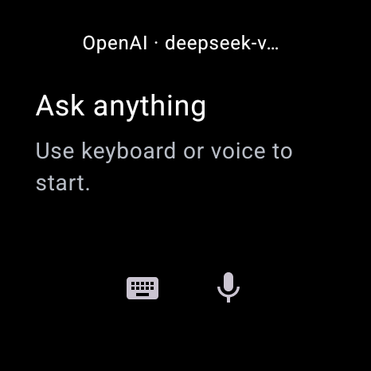
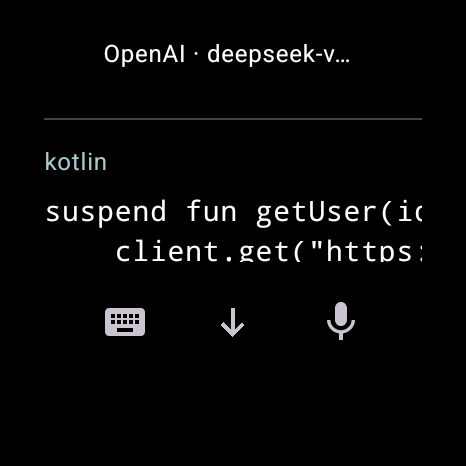
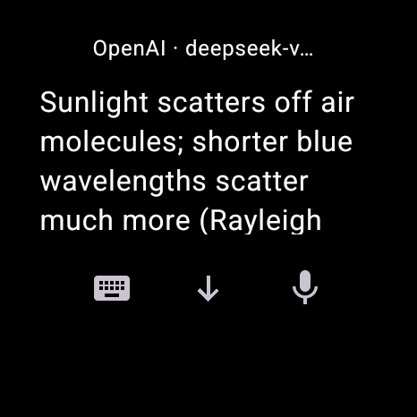
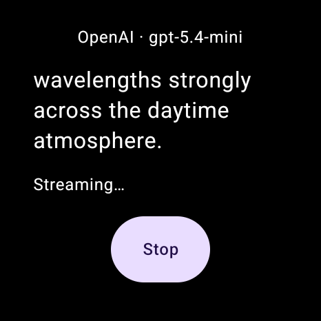
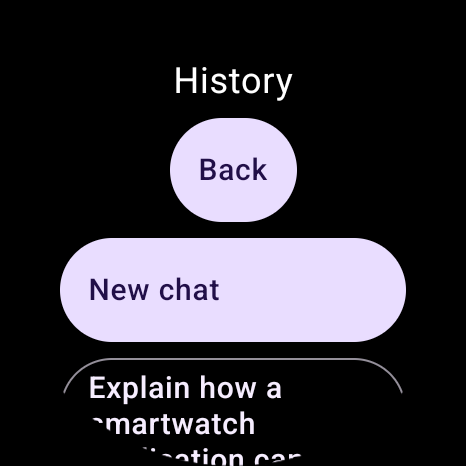

<div align="center">


# NiroWear

**A standalone bring-your-own-key AI chat client for Wear OS, designed for 466 x 466 px round watches.**

[](https://github.com/michaelxdips/NiroWear/actions/workflows/ci.yml)
[](https://github.com/michaelxdips/NiroWear/releases)
[](LICENSE)


[Features](#features) · [Install](#install) · [Provider setup](#provider-setup) · [Build](#build-from-source) · [Architecture](#architecture) · [Evidence](#testing-and-evidence) · [Limitations](#known-limitations)

**Website: [michaelxdips.github.io/NiroWear](https://michaelxdips.github.io/NiroWear/)**

</div>

---

## Overview

NiroWear connects from your watch straight to the AI provider endpoint using your own API key. There is no account, no relay server, and no analytics telemetry. API keys are encrypted locally via Android Keystore and sent only to the base URL you configure.

Instead of truncating replies or wrapping a full response in a single text container, NiroWear parses Markdown into semantic blocks (`Paragraph`, `Heading`, `List`, `Quote`, `CodeBlock`, `Math`, `Table`, `Divider`), typesets LaTeX natively, turns multi-column tables into labelled vertical records, and lets wide formulas and code blocks scroll horizontally inside the circular safe ring (`466 x 466 px` reference viewport, Xiaomi Watch 2 class).

> NiroWear is an independent MIT-licensed project by Stephen Michael and is not affiliated with OpenAI, Google, or Anthropic. "Wear OS" and "Android" are trademarks of Google LLC.

<table>
<tr>
<td align="center"><br /><sub><b>New chat</b></sub></td>
<td align="center"><br /><sub><b>Horizontal code pan</b></sub></td>
<td align="center"><br /><sub><b>Tables as records</b></sub></td>
</tr>
<tr>
<td align="center"><br /><sub><b>Mixed Markdown</b></sub></td>
<td align="center"><br /><sub><b>Streaming and Stop</b></sub></td>
<td align="center"><br /><sub><b>History and search</b></sub></td>
</tr>
</table>

## Features

### Document Reader

- **Semantic blocks from stored raw Markdown:** `ResponseParser` produces discrete heading, paragraph, bullet/numbered list, quote, code block, inline/display math, table, and divider blocks. Room stores raw Markdown so future parser updates require no schema migration.
- **Native LaTeX typesetting in all build types:** uses JLaTeXMath to render Greek symbols, operators, integrals, sums, limits, fractions, roots, `bmatrix`, `cases`, and aligned equations. Wide formulas are typeset once (at most down to half scale before falling back to readable source) and scroll horizontally inside the reader.
- **Labelled vertical records and chunked code fences:** tables emit one lazy item per row with repeated column headers so long tables (verified to 120 rows) remain completely reachable. Code fences split into 24-line lazy chunks (verified to 200 lines) with an edge pan cue.
- **Accessible links:** inline links expose a bounded per-paragraph action list and a single actionable semantics group for screen readers.

### Chat, Streaming, and Editing

- **Frame-coalesced streaming:** tokens coalesce at a 16 ms budget (one parse pass per frame) via `StreamParse` and single-flight `parseDispatcher` with safe top-level prefix caching. Scrolling up during output pauses auto-follow and surfaces a `Latest` button instead of pulling the viewport back down.
- **Deterministic Stop:** cancels the active OkHttp call, retains any received text with `STOPPED` status, and never automatically replays output on the next prompt.
- **Linear edit and retry:** editing an earlier user prompt replaces that row, truncates later rows in one Room transaction, and generates a single continuation with no conversation branching.
- **Full local search:** multi-term ASCII `LIKE` search across stored messages (`SearchHit`).

### Keyboard, Voice, and Phone Pairing

- **Dual watch entry:** voice recognition opens the platform recognizer and returns editable draft text; keyboard input consumes Android 15+ IME window insets under `adjustResize` (`targetSdk 37`) and persists Back-exit drafts in Room (`composer_draft`, v3).
- **Phone LAN pairing:** `Set up from phone` opens a 120-second single-use `https://` listener bound to private LAN addresses only, delivered via NFC HCE NDEF tag, QR code, or displayed URL. Key payloads use ephemeral ECDH P-256 + AES-GCM before transmission.

### Credentials and Localization

- **AES-256-GCM key storage:** keys are encrypted under a non-exportable Android Keystore key with a version byte, 12-byte IV, and credential-reference AAD (`SecretStore`). Decryption failures require re-entry without plaintext fallback; `FLAG_SECURE` protects entry screens; `allowBackup` is disabled.
- **English and Indonesian parity:** `values/strings.xml` and `values-in/strings.xml` each contain **127 matching keys** (0 missing, 0 extra, checked 2026-11-26: `v0.2.2` shipped 125 keys, PR #83 added `chat_draft_unavailable`, and `v0.3.0` added `failure_answer_not_saved`). Stored error tokens resolve cleanly at render time.

## Install

1. Download `app-release.apk` from the [latest release](https://github.com/michaelxdips/NiroWear/releases/latest).
2. Install on your watch over ADB (`adb install -r app-release.apk`).

Needs Wear OS 3+ (`minSdk 30`), 32- or 64-bit ARM, 3.6 MB of storage, and a provider key you own, typed on the watch or sent from a phone on the same Wi-Fi. No account, no relay, no server of ours.

**Upgrading:** `0.1.1` through `0.3.0` share `CN=NiroWear Release` (`0D:C5:0F:C0:19:...86:54:3E`) and upgrade in place. Builds from `0.1.0` or earlier used `CN=Android Debug` and require uninstalling first (which deletes device-bound keys and chats).

Verify the downloaded binary against the release notes:

```bash
aapt2 dump badging app-release.apk | head -3    # versionCode 16, versionName 0.3.0
sha256sum app-release.apk                       # d94a5af3755b1c3d86257525cd643042db4cf64d7f755cbcdcab5ea23e040ca2
```

## Provider setup

Protocol selection depends strictly on the provider adapter you choose, never on the model name string:

| Adapter | Endpoint | System instruction mapping | Terminal event | Model discovery |
|---|---|---|---|---|
| **OpenAI** | `POST {base}/responses` | `instructions` | `response.completed` | `GET /models` |
| **OpenAI-compatible** | `POST {base}/chat/completions` | leading `system` role | `finish_reason: "stop"` | Optional; manual ID always works |
| **Gemini** | `POST {base}/models/{model}:streamGenerateContent?alt=sse` | `systemInstruction` | `finishReason: "STOP"` | Filtered by generation capability |
| **Anthropic** | `POST {base}/messages` | top-level `system` | `message_stop` | `GET /models` |

Add a provider under **Menu -> Providers / model -> Add...**. Profiles save offline or behind captive portals without requiring a live validation call, invalid keys fail explicitly at first send, and missing discovery endpoints never block manual model IDs.

## Build from source

Requirements: JDK 17+ (built against Android Studio JBR), Android SDK 37, and Gradle dependencies. On Windows use `gradlew.bat` with `JAVA_HOME` configured.

```bash
git clone https://github.com/michaelxdips/NiroWear.git
cd NiroWear

# Full CI JVM, lint, style, and assembly gate
./gradlew :app:testDebugUnitTest :app:lintDebug :app:ktlintCheck \
          :app:assembleDebug :app:assembleRelease
```

Instrumented tests wipe app state between classes (`pm clear com.nirowear`) and require an emulator or test device (`adb shell wm size 466x466 && adb shell wm density 320` on non-466 AVDs):

```bash
./gradlew :app:connectedDebugAndroidTest
```

Release signing keys are supplied exclusively through environment variables (`NIROWEAR_KEYSTORE`, `NIROWEAR_KEYSTORE_PASSWORD`, `NIROWEAR_KEY_ALIAS`, `NIROWEAR_KEY_PASSWORD`). Local builds without those variables produce an unsigned APK (`app-release-unsigned.apk`).

## Architecture

Single `:app` module written in Kotlin with Jetpack Compose for Wear OS Material 3, Room, DataStore, OkHttp, `kotlinx.serialization`, CommonMark, ZXing, and JLaTeXMath.

```text
com.nirowear
├── chat/       ChatViewModel (turn lifecycle, streaming, linear edit/retry/stop)
│   ├── StreamParse.kt     16 ms coalescer and bounded 3-conversation parse cache
│   └── ReaderAnchor.kt    saved-state scroll restoration
├── data/       Room schema v3 (conversations, messages, openai_phases, composer_draft) + DataStore settings
├── provider/   OpenAI Responses, OpenAI-compatible, Gemini, and Anthropic SSE adapters
├── renderer/   ResponseParser -> ContentBlock -> RenderUnit -> Compose
│   ├── RenderUnit.kt      lazy units: 1 item per table row, 24 lines per code chunk
│   └── NativeMathRenderer JLaTeXMath bounded bitmap + readable fallback
├── security/   SecretStore (Keystore AES-256-GCM, no plaintext fallback)
└── settings/   Provider forms, FLAG_SECURE credential entry, LAN + NFC pairing service
```

Further notes: [`ARCHITECTURE.md`](docs/memory/ARCHITECTURE.md) · [`PROVIDERS.md`](docs/memory/PROVIDERS.md) · [`RENDERER.md`](docs/memory/RENDERER.md) · [`SCOPE.md`](docs/memory/SCOPE.md) · [`docs/adr/`](docs/adr/)

## Testing and evidence

Every metric below comes from recorded runs and XML/log artifacts in this repository. Emulator figures use headless SwiftShader on Wear OS 5 (`nirowear-b`, API 34, `466 x 466 px @ 320 dpi`); physical Xiaomi Watch 2 checks are listed separately with their exact run dates.

### Current v0.3.0 Verification (JVM, CI, and API 34 AVD)

| Check | Measured result | Source |
|---|---|---|
| **JVM unit suite** | **316 tests, 51 suites, 0 failures, 1 skipped** (`LiveProviderSmokeTest`, opt-in env vars) | `app/build/test-results/testDebugUnitTest/*.xml` |
| **Android Lint & ktlint** | `lintDebug`: **0 errors, 1 warning** (`VisibleForTests`); `ktlintCheck`: **0 violations** | `app/build/reports/lint-results-debug.xml` |
| **CI instrumented smoke** | **10/10 classes** green on Wear OS 5 API 34 (`466 x 466 px @ 320 dpi`), required for `main` merges | `.github/workflows/ci.yml` |
| **AVD closeout gate (`nirowear-b`)** | **11/11 classes (`19` tests, `0` failures)** covering TalkBack traversal, Room v3 draft atomic Send, code pan cue, localized notices, and compact header bounds | `app/src/androidTest/` |
| **Signed `v0.3.0` release on AVD** | `versionCode 16`, **3,779,197 B**, SHA-256 `d94a5af3...`, `v0.2.1 -> v0.3.0` upgrade 0 FATAL; cold start **549 ms** median (`572, 549, 567, 531, 534 ms`), first frame **365.993 ms** median, warm **37 ms** median, PSS **30,836 KB**, scroll **377 frames / 2.92% jank** | `v0.3.0` tag workflow + AVD logs |
| **5,000-msg upgrade & scroll (AVD)** | Raw SQLite v2 (`2.json`, hash `9ae11899...`) with **200 conversations / 5,000 messages** migrated cleanly to Room v3 in **286.48 ms**; 50 searches **0.53 ms** median (**4.15 ms** P95, **2.298 ms** warm max, **31.03 ms** first cold query); History 18-swipe scroll **494 frames / 2.23% jank** (P50 `8 ms`, P95 `20 ms`) | `AvdGapProbesTest` (`feat/avd-gap-probes`) |
| **4 KB stream & torture scroll (AVD)** | Incremental stream parse P50/P95 **0.463 / 1.080 ms** (4 KB pipe-free P95 `11.735 ms`, mixed P95 `12.077 ms`); 4,485 B `RENDER_TORTURE_FIXTURE.md` 18-swipe debug scroll **460 frames / 6.09% jank** (P50 `21 ms`, P95 `31 ms` on SwiftShader) | `ResponseParserStreamingPerfTest` |

### Historical Physical Watch Evidence (Xiaomi Watch 2, `axolotlaxie`, API 34)

Physical watch testing was skipped for `v0.3.0` (tracked under `#27`, `#65`, `#89`). Prior hardware measurements on record:

- **2026-11-16 (`v0.2.1`, signed release, `armeabi-v7a`):** cold-start median **723 ms** (5 runs, `720-1,105 ms`); per-class suite `25/43` passed (11 `adb: device offline` transport drops); defects filed (`#47` crown absent, `#48` API 34 table semantics, `#49` fixed Arabic digits inside English text, `#50` superseded by `#84`).
- **2026-11-17 (`23efc01`, debug build):** debug cold-start **4375.5 ms** median (`4311, 4345, 4406, 4619 ms`; `#65`, caused by 4.5 KB fixture read on debug main thread), hardware Adreno scroll **761 frames, 1.18% jank** (`50th 8 ms`), 20-min stress **PSS +3.2 MB** with `Thermal Status: 0`, `454 x 454` override verified no control clipping, `Stop` button centered (`dx = 0, dy = 0`), per-class instrumented sweep **38 of 45 passed** (`4` teardown `UiAutomation` crashes reconciled in `#84`).

**Host-driven process-death gates:** six `@HostDrivenGate` tests are excluded from the default runner via `notAnnotation` in `app/build.gradle.kts` and require host orchestration scripts across `am force-stop`; last recorded run on Wear OS 37 AVD passed all six.

## Known limitations

- **Hardware checks skipped on `v0.3.0`:** battery drain percentage, sustained thermal levels above `Thermal Status: 0`, TalkBack spoken audio on hardware speakers, voice dictation accuracy, rotary crown scrolling (`#47`), and real phone-to-watch certificate click-through (`#28`) remain unverified on `v0.3.0` hardware.
- **Shipping `v0.3.0` upgrade injection blocked by security policy:** `allowBackup="false"` and `debuggable=false` prevent seeding a pre-populated v2 database directly into the signed release container without root (`O4` migration was verified on `nirowear-b` using exact schema `2.json` -> `3.json`).
- **Open tracked issues:** `#27` (physical watch acceptance), `#28` (phone pairing cert click-through), `#47` (rotary absence), `#48` (table semantics on API 34 hardware), `#62` (composer lost-word trace), `#65` / `#89` (release watch timings), `#84` (hardware teardown-crash logcat replacing closed `#50`).
- **Parser & math bounds:** `NativeMathRenderer` caps memory and bitmap bounds, refusing file-inclusion macros, macro definitions, and unbalanced braces by degrading to readable LaTeX source. Nested code fences inside blockquotes or tables wider than their header row degrade safely without losing earlier content.

## Security and license

API keys remain on device as AES-GCM ciphertext and transmit only to configured provider URLs. Threat model details live in [SECURITY.md](SECURITY.md) and [docs/release/PRIVACY.md](docs/release/PRIVACY.md).

Application source is **MIT** licensed ([LICENSE](LICENSE)). Third-party notices and license texts (including JLaTeXMath GPL-2.0 with its linking exception, MPL-2.0 Public Suffix List, and Apache-2.0 AndroidX components) ship under `assets/legal/`, [THIRD_PARTY_NOTICES.md](THIRD_PARTY_NOTICES.md), and [docs/licenses/](docs/licenses/).
