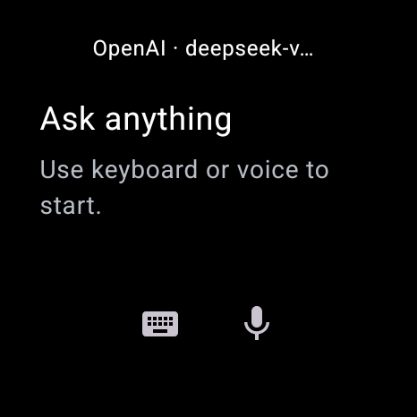
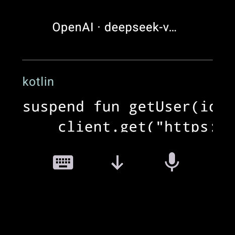
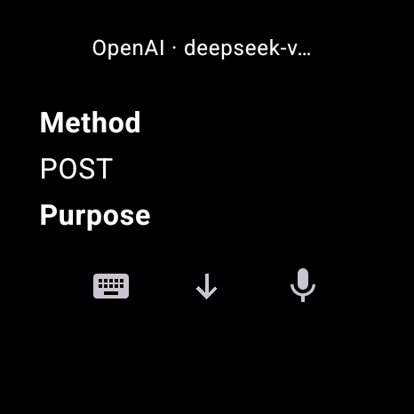

<div align="center">

# NiroWear

**BYOK AI chat for Wear OS. Your provider, your key, your watch.**

Streamed answers that read like a document — Markdown, code, math, tables and links — on a 466 × 466 round display.

[](LICENSE)
[](#requirements)
[](https://kotlinlang.org)

[Features](#features) · [Install](#install) · [Provider setup](#provider-setup) · [Architecture](#architecture) · [Contributing](#contributing)

</div>

---

## What this is

NiroWear is a standalone Wear OS chat client that talks **directly** to the AI provider you choose, using **your own API key**. There is no NiroWear account, no backend, no relay and no analytics. Your key is encrypted on the watch with the Android Keystore and is sent only to the endpoint you configured.

It exists because every other way of reading an AI answer on a watch is a compromise: mirrored phone notifications truncate, voice-only assistants can't show a code block, and mobile apps assume a 6-inch screen. NiroWear treats the watch as the primary device.

**Reference viewport:** 466 × 466 px, round (Xiaomi Watch 2 class). Everything is designed against that, not scaled down from a phone.

## Features

**Four real adapters, four real protocols.** OpenAI Responses, Anthropic Messages, Google Gemini GenerateContent, and generic OpenAI-compatible Chat Completions. The protocol is chosen by the provider type you select — never guessed from a model name. Adding a model never silently changes the wire format.

**Bring your own key, stored properly.** Keys are encrypted with AES-GCM under a non-exportable Android Keystore key. Only versioned ciphertext and nonce touch disk; a profile stores a credential *reference*, never the key. A decrypt failure demands re-entry — there is no plaintext fallback, and a saved key is never repopulated into an editing field.

**No typing required for setup.** The watch serves a one-time page on your local network; you open the URL on a phone or laptop and paste the key into a real form. The payload is encrypted end-to-end with ephemeral ECDH P-256 and AES-GCM, so nothing sensitive crosses the LAN in clear text. Manual entry is always available underneath.

**Streaming with honest interruption.** Tokens render as they arrive. Scroll up and the view stops following you, with a small `Latest` control to jump back. `Stop` cancels the underlying HTTP request and keeps whatever partial answer had already arrived — it is never replayed automatically.

**One linear conversation.** Editing an earlier user message replaces it, deletes everything after it, and regenerates from that point. There are no branches and no alternate-response variants to choose between. Switching provider or model keeps the same history, and each assistant message records which profile and model produced it.

**A reader, not a bubble.** Assistant output is parsed into semantic blocks — headings, paragraphs, lists, quotes, inline code, fenced code, display math, tables, dividers, links — and rendered as a document. Raw Markdown is stored, so the renderer can improve without a migration.

**Wide content stays readable.** Code and formulas are never shrunk into illegibility. They pan horizontally inside a single vertical reader, so a long line costs a swipe rather than your eyesight. Tables become labelled vertical records instead of a 4-column grid squeezed into 466 px.

**Watch-sized answers by default.** The system instruction asks for the shortest answer that keeps the required facts and caveats, and to expand when you ask for detail. The client never truncates a long answer to fit the screen.

**Keyboard and voice.** Both are first-class entry points. Voice delegates to the platform recognizer and always returns text you can review before sending.

## Screenshots

Uncropped 466 × 466 captures from the app running against a real HTTPS endpoint.

<table>
  <tr>
    <td align="center"><br /><strong>New chat</strong></td>
    <td align="center"><br /><strong>Streamed answer</strong></td>
  </tr>
  <tr>
    <td align="center"><br /><strong>Streaming + Stop</strong></td>
    <td align="center"><br /><strong>Code reader</strong></td>
  </tr>
  <tr>
    <td align="center"><br /><strong>Tables as records</strong></td>
    <td align="center"><br /><strong>History</strong></td>
  </tr>
</table>

## Requirements

| | |
|---|---|
| Device | Wear OS 3 or newer (API 30+), round display recommended |
| Build JDK | 25 (the Gradle daemon toolchain pins it; app bytecode targets Java 17) |
| Android SDK | Platform 36, build-tools matching |
| Gradle | Provided by the checked-in wrapper — do not install separately |

NiroWear is a **standalone** Wear app: it does not require a phone companion and works over the watch's own Wi-Fi or its Bluetooth bridge.

## Install

There is no store listing. Two supported routes:

**Prebuilt APK** — grab the latest release from [NiroWear-Beta](https://github.com/michaelxdips/NiroWear-Beta/releases). These are signed release builds; the source in *this* repository builds the same app.

**From source**

```powershell
.\gradlew.bat :app:assembleDebug
adb install -r app\build\outputs\apk\debug\app-debug.apk
```

Then open NiroWear and configure a provider (below).

> The debug variant links an experimental native-math renderer whose upstream licensing is not cleared for redistribution. Build debug for your own device; do not redistribute debug APKs. Release builds use the source-fallback math renderer and are what the published releases are made from.

## Provider setup

Open **Menu → Providers / model** and pick a preset:

| Preset | Default base URL | Wire protocol |
|---|---|---|
| OpenAI | `https://api.openai.com/v1` | Responses |
| Anthropic | `https://api.anthropic.com/v1` | Messages |
| Gemini | `https://generativelanguage.googleapis.com/v1beta` | GenerateContent (SSE) |
| OpenAI-compatible | *(you supply)* | Chat Completions |

Name and base URL come prefilled. Then get the key onto the watch:

1. Tap **Set up from phone**.
2. The watch shows a URL like `http://192.168.1.24:41234/`.
3. Open it on your phone or laptop, pick the provider, paste the key, tap **Send to watch**.
4. The watch saves, validates, and lists models on its own.

The pairing page is valid for **two minutes and one use**, and the socket closes the moment you leave the screen. If your watch has no Wi-Fi address, the screen says so and you can type the key manually instead.

**Validate · uses API** makes one real (billable) call against the selected model to prove the key and model work together. **Discover models** lists what the provider advertises; discovery failure never blocks manual entry, because compatible endpoints legitimately vary.

### Why keys are annoying, and what we did

An API key is 40–200 opaque characters. Typing that on a 1.4-inch keyboard is not a friction problem, it is a correctness problem — the failure mode is a silent typo. So the transport was the thing to fix, not the keyboard. The pairing page puts the key on a device with a real keyboard, and the watch only ever receives it.

Because setup happens **once**, a URL and a form are cheap. After that, the app just uses whatever network the watch already has.

## Architecture

One application module, no over-engineering:

```
Wear Compose UI  →  ChatViewModel  →  LlmProvider adapter  →  OkHttp → provider
                         ↓
                  Room (history)  +  DataStore (profiles)  +  SecretStore (Keystore)
```

- **Kotlin + Jetpack Compose for Wear OS Material 3**, Coroutines/Flow, Room, DataStore, OkHttp, kotlinx.serialization.
- **Canonical history is provider-neutral**: USER/ASSISTANT raw content only. Adapters own instruction mapping, request construction, SSE parsing and semantic completion. EOF alone is not success — adapters detect each protocol's terminal event.
- **One generation job per request.** Cancellation propagates into the OkHttp call. Partial text is durable across Stop, error and process death.
- **Renderer** parses semantic blocks off the main thread; raw Markdown is retained so the renderer can evolve.
- **No backend.** The only network calls are to the endpoint you configured.

Deeper reading: [ARCHITECTURE.md](docs/memory/ARCHITECTURE.md), [PROVIDERS.md](docs/memory/PROVIDERS.md), [RENDERER.md](docs/memory/RENDERER.md), [SCOPE.md](docs/memory/SCOPE.md).

## Security & privacy

- Keys encrypted with **AES-GCM** under an Android Keystore key; ciphertext + nonce only, no plaintext fallback.
- Masked entry by default; provider screens set `FLAG_SECURE` so they cannot be screenshotted by other apps.
- Release networking requires **HTTPS** with platform trust. Redirects and automatic retries are disabled. Credential-bearing URL query strings are rejected.
- `android:allowBackup="false"` — credentials are device-bound, so clearing data or uninstalling removes them permanently.
- **No analytics, no crash reporting, no NiroWear backend.**
- Chat text and the key go directly to the endpoint you chose; that provider's retention policy then applies, not ours.

Full facts: [PRIVACY.md](docs/release/PRIVACY.md).

## Known limitations

Stated plainly, because a README that hides these is useless:

- **Native math typesetting is not in release builds.** LaTeX renders through a source fallback — readable and pannable, not typeset. The native path exists in debug only, pending upstream license clearance.
- **Physical Xiaomi Watch 2 acceptance is incomplete.** Emulator evidence is extensive; real-device battery, thermals and input are not yet verified.
- **Voice transcription quality is unaccepted.** The intent launch/return path is tested; recognition accuracy is the platform's.
- **Link taps** open via the system handler; destination completion on a real paired device is unverified.
- **Live smoke tests** are documented against controlled endpoints and one third-party Responses endpoint — not against every official provider with production credentials.
- **TalkBack audio** acceptance is incomplete.

## Contributing

Issues and pull requests are welcome. Read [CONTRIBUTING.md](CONTRIBUTING.md) and [AGENTS.md](AGENTS.md) first — the latter documents the product and engineering contracts that keep the app coherent.

Two rules that matter more than style: **never commit a real API key**, and **do not add a feature from the out-of-scope list** in [SCOPE.md](docs/memory/SCOPE.md) without discussing it first.

## License

Application source is **MIT** — see [LICENSE](LICENSE). Copyright © 2026 Stephen Michael.

Third-party dependencies keep their own licenses; see [THIRD_PARTY_NOTICES.md](THIRD_PARTY_NOTICES.md) and [docs/licenses](docs/licenses/README.md). The one non-permissive build-time dependency (`jlatexmath-android`, GPL with a linking exception) is debug-only and is not redistributed here.

"Wear OS" and "Android" are trademarks of Google LLC. NiroWear is not affiliated with or endorsed by Google, OpenAI, Anthropic, or any model provider.
