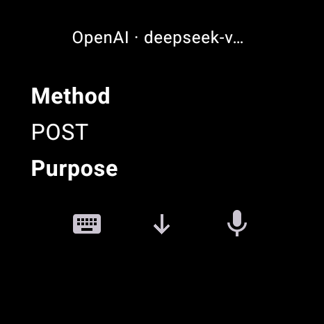

<div align="center">


# NiroWear

**Bring-your-own-key AI chat client for Wear OS (466 x 466 px round watches).**

[](https://github.com/michaelxdips/NiroWear/actions/workflows/ci.yml)
[](https://github.com/michaelxdips/NiroWear/releases/latest)
[](LICENSE)


[Install](#install) · [Capabilities](#capabilities) · [Providers](#provider-setup) · [Architecture](#architecture) · [Build](#build-from-source) · [Evidence](#testing-and-evidence) · [Limitations](#known-limitations)

[michaelxdips.github.io/NiroWear](https://michaelxdips.github.io/NiroWear/) · [Release 0.3.2 notes](docs/release/RELEASE_NOTES_0.3.2.md)

</div>

---

NiroWear connects directly from a Wear OS watch to your chosen AI provider endpoint using your own API key. Keys are encrypted on-device with Android Keystore and transmitted only to the base URL configured in your profile.

Assistant answers render as a scrollable document inside a `466 x 466 px` circular safe area (Xiaomi Watch 2 class). `ResponseParser` splits stored raw Markdown into discrete heading, paragraph, list, quote, code, math, table, and divider blocks, JLaTeXMath typesets formulas natively, multi-column tables unwrap into labelled vertical records, and wide code or math blocks pan horizontally.

> NiroWear is an independent MIT-licensed project by Stephen Michael and is not affiliated with OpenAI, Google, or Anthropic. "Wear OS" and "Android" are trademarks of Google LLC.

<table>
<tr>
<td align="center"><br /><sub><b>New chat</b></sub></td>
<td align="center"><br /><sub><b>Horizontal code pan</b></sub></td>
<td align="center"><br /><sub><b>Tables as records</b></sub></td>
</tr>
<tr>
<td align="center"><br /><sub><b>Mixed Markdown</b></sub></td>
<td align="center"><br /><sub><b>Streaming and Stop</b></sub></td>
<td align="center"><br /><sub><b>History and search</b></sub></td>
</tr>
</table>

## Install

1. Download `app-release.apk` from the [latest release](https://github.com/michaelxdips/NiroWear/releases/latest).
2. Install on your watch over ADB: `adb install -r app-release.apk`.

Needs Wear OS 3+ (minSdk 30), 32- or 64-bit ARM, 3.6 MB of storage, and a provider key you own, typed on the watch or sent from a phone on the same Wi-Fi. No account, no relay, no server of ours.

Verify the `0.3.2` (`versionCode 18`, `3,778,806 B`) release APK before installing:

```bash
aapt2 dump badging app-release.apk | head -3    # versionCode=18, versionName=0.3.2
sha256sum app-release.apk                       # 0f0a46124b8470f3b45350f5d68289c818fc22bc63fb7c83cb515c1200ac29eb
```

Releases `0.1.1` through `0.3.2` share the `CN=NiroWear Release` signing certificate and upgrade in place. Earlier `0.1.0` builds used `CN=Android Debug` and must be uninstalled first, which clears device-bound keys and chats.

## Capabilities

### Watch-native document reader

Room stores raw assistant Markdown so future parser updates apply to saved threads without schema changes. At render time, the reader produces:

- Native LaTeX via JLaTeXMath across both debug and release builds, covering Greek symbols, operators, integrals, sums, limits, fractions, roots, `bmatrix`, `cases`, and aligned equations. Wide formulas render once (capped at half scale before falling back to readable source) and scroll horizontally.
- Multi-column Markdown tables emitted as one lazy item per row with repeated column headers (verified to 120 rows).
- Fenced code blocks split into 24-line lazy chunks (verified to 200 lines) with a conditional fade and slate edge pan cue.
- Bounded per-paragraph inline link actions grouped into a single semantics target for TalkBack (`Menu -> Reader/Menu -> Footer` traversal).

### Streaming, editing, and history

- Incoming SSE deltas coalesce at a 16 ms frame budget via `StreamParse` and single-flight `parseDispatcher` with safe top-level prefix caching. When you scroll up during output, auto-follow pauses and a `Latest` action appears to jump back to the end.
- Tapping `Stop` cancels the active OkHttp call and keeps received partial text under `STOPPED` status. The next prompt sends a fresh request and never replays prior partial output.
- Editing an earlier user message replaces that row, deletes subsequent messages in one Room transaction, and generates a single linear continuation.
- History supports multi-term ASCII `LIKE` search (`SearchHit`) across all stored conversations.

### Input, pairing, security, and localization

- Voice recognition opens the platform speech recognizer and returns editable draft text; keyboard input consumes Android 15+ IME window insets under `adjustResize` (`targetSdk 37`) and saves Back-exit drafts atomically in Room (`composer_draft`, schema v3).
- `Set up from phone` opens a 120-second single-use `https://` listener bound only to private LAN addresses, reachable via NFC HCE NDEF tag, QR code, or displayed URL. Key payloads encrypt with ephemeral ECDH P-256 + AES-GCM before transmission.
- `SecretStore` encrypts API keys using a non-exportable Android Keystore AES-256-GCM key with a version byte, 12-byte IV, and credential-reference AAD. Keystore decryption failure fails closed and prompts for re-entry; credential entry screens set `FLAG_SECURE`, and `allowBackup` is disabled.
- English (`values/strings.xml`) and Indonesian (`values-in/strings.xml`) match at 127 keys each (`v0.2.2` shipped 125 keys, `#83` added `chat_draft_not_saved`, and `v0.3.0` added `failure_answer_not_saved`). Stored error tokens resolve to localized strings at render time.

## Provider setup

Adapter selection determines the wire protocol explicitly; NiroWear never guesses an endpoint from a model name string.

| Adapter | Endpoint | System instruction mapping | Terminal event | Model discovery |
|---|---|---|---|---|
| **OpenAI** | `POST {base}/responses` | `instructions` | `response.completed` | `GET /models` |
| **OpenAI-compatible** | `POST {base}/chat/completions` | leading `system` role | `finish_reason: "stop"` | Optional; manual ID always works |
| **Gemini** | `POST {base}/models/{model}:streamGenerateContent?alt=sse` | `systemInstruction` | `finishReason: "STOP"` | Filtered by generation capability |
| **Anthropic** | `POST {base}/messages` | top-level `system` | `message_stop` | `GET /models` |

Add a provider under **Menu -> Providers / model -> Add...**. Profiles save offline or behind captive portals; invalid keys report errors on the first send, and missing model discovery endpoints accept any manually entered model ID.

## Architecture

Single `:app` module in Kotlin using Jetpack Compose for Wear OS Material 3, Room, DataStore, OkHttp, `kotlinx.serialization`, CommonMark, ZXing, and JLaTeXMath.

```text
com.nirowear
├── chat/       ChatViewModel (turn lifecycle, streaming, linear edit/retry/stop)
│   ├── StreamParse.kt     16 ms coalescer and bounded 3-conversation parse cache
│   └── ReaderAnchor.kt    saved-state scroll restoration
├── data/       Room schema v3 (conversations, messages, openai_phases, composer_draft) + DataStore settings
├── provider/   OpenAI Responses, OpenAI-compatible, Gemini, and Anthropic SSE adapters
├── renderer/   ResponseParser -> ContentBlock -> RenderUnit -> Compose
│   ├── RenderUnit.kt      lazy units: 1 item per table row, 24 lines per code chunk
│   └── NativeMathRenderer JLaTeXMath bounded bitmap + readable fallback
├── security/   SecretStore (Keystore AES-256-GCM, fail-closed on decryption error)
└── settings/   Provider forms, FLAG_SECURE credential entry, LAN + NFC pairing service
```

Further documentation: [`ARCHITECTURE.md`](docs/memory/ARCHITECTURE.md) · [`PROVIDERS.md`](docs/memory/PROVIDERS.md) · [`RENDERER.md`](docs/memory/RENDERER.md) · [`SCOPE.md`](docs/memory/SCOPE.md) · [`docs/adr/`](docs/adr/)

## Build from source

Requirements: JDK 17+ (built against Android Studio JBR), Android SDK 37 (`minSdk 30`), and Gradle dependencies. On Windows, run `gradlew.bat` with `JAVA_HOME` set.

```bash
git clone https://github.com/michaelxdips/NiroWear.git
cd NiroWear

# Full CI JVM, lint, style, and assembly gate
./gradlew :app:testDebugUnitTest :app:lintDebug :app:ktlintCheck \
          :app:assembleDebug :app:assembleRelease
```

Instrumented tests clear app state between classes (`pm clear com.nirowear`) and require an emulator or dedicated test device (`adb shell wm size 466x466 && adb shell wm density 320` on non-466 AVDs):

```bash
./gradlew :app:connectedDebugAndroidTest
```

Release signing keys come solely from environment variables (`NIROWEAR_KEYSTORE`, `NIROWEAR_KEYSTORE_PASSWORD`, `NIROWEAR_KEY_ALIAS`, `NIROWEAR_KEY_PASSWORD`). Local builds without those variables emit `app-release-unsigned.apk`.

## Testing and evidence

Every figure below comes directly from recorded test XML, Gradle reports, and AVD/watch logs on this tree. Emulator checks ran on Wear OS 5 (`nirowear-b`, API 34, `466 x 466 px @ 320 dpi`, headless SwiftShader); dated Xiaomi Watch 2 hardware measurements sit in their own collapsible table below.

### Release v0.3.2 verification summary

| Gate | Result | Scope | Source |
|---|---|---|---|
| **JVM unit suite** | **319 passed, 1 skipped** (320 tests / 51 suites, `0` failures, `LiveProviderSmokeTest` opt-in) | Host JVM (`-Xss1m`) | `app/build/test-results/testDebugUnitTest/*.xml` |
| **Lint & ktlint** | `lintDebug`: **0 errors, 0 code warnings** (7 pinned dependency-update advisories); `ktlintCheck`: **0 violations** | Host | `app/build/reports/lint-results-debug.xml` |
| **Locale parity** | **127 matching keys** (`values/` == `values-in/`), 0 missing/extra | Host + AVD / Watch 2 | `IndonesianReaderNoticesTest`, `IndonesianHeaderAndInputTest` |
| **CI instrumented smoke** | **10/10 classes** green, enforced on `main` | GitHub CI AVD (API 34) | `.github/workflows/ci.yml` |
| **Watch 2 (`v0.3.2` debug + `v0.3.1` signed)** | Debug sweep: `InputResultUiTest` **8/8**, `IndonesianReaderNoticesTest` **1/1** (`id-ID`), `CompatibleChatTest` **4/4**, `ComposerSendReachabilityTest` **2/2**, `PairingUiTest`/`ComposerImeCommitTest`/`ComposerSendButtonTest`/`InputControlsUiTest`/`TalkBackTraversalOrderTest`/`ReaderSemanticsTest`/`QuoteSemanticsTest` (`1/1` each) + `ReaderNavigationTest` **7/7**; signed `v0.3.1` cold **694 ms**, warm **71 ms**, **PSS 31,575 KB**, `Thermal Status: 0` | `Xiaomi Watch 2` (`v0.3.2`-prep & `v0.3.1`) | `.private/watch2-v032/`, `.private/watch2-v031/` |
| **AVD closeout baseline (`v0.3.0`)** | **11/11 classes (`19` tests, `0` failures)**; signed release cold **549 ms**, first frame **365.993 ms**, warm **37 ms**, scroll **2.92%** (`377` frames), PSS **30,836 KB** | `nirowear-b` (`versionCode 16`) | `.private/v030-release-avd/` |
| **`O4` 5,000-msg upgrade** | Room v2->v3 (**200 convs / 5,000 msgs**) in **286.48 ms** | `nirowear-b` (schema probe) | Recorded AVD probe run (`nirowear-b`, local `feat/avd-gap-probes`) |
| **`J5` / `J2` / `J4` probes** | Search **0.53 ms** med / **4.15 ms** P95, History scroll **2.23%** (`494` frames); torture debug scroll **6.09%** (`460` frames); 4 KB stream P95 **1.080 ms** | `nirowear-b` (debug + SwiftShader) | Recorded AVD probe run (`nirowear-b`), `ResponseParserStreamingPerfTest` |

<details>
<summary>v0.3.2 Watch 2 sweep, v0.3.1 signed Watch 2 baseline & v0.3.0 AVD probe breakdown</summary>

#### Watch 2 (`v0.3.2`-prep debug sweep, `192.168.8.18:5555`, `armeabi-v7a`, API 34) & signed `v0.3.2` (`3,778,806 B`, SHA-256 `0f0a46124b8470f3b45350f5d68289c818fc22bc63fb7c83cb515c1200ac29eb`)

- Post-final-edit debug runs (`screen_off_timeout` raised to `600000` ms during tests and restored to `15000` ms after): `InputResultUiTest` **8/8**, `IndonesianReaderNoticesTest` **1/1** (under temporary `id-ID` per-app locale), `CompatibleChatTest` **4/4**, `ComposerSendReachabilityTest` **2/2**, `PairingUiTest` **1/1**, `ComposerImeCommitTest` **1/1**, `ComposerSendButtonTest` **1/1**, `InputControlsUiTest` **1/1**, `TalkBackTraversalOrderTest` **1/1**, `ReaderSemanticsTest` **1/1**, and `QuoteSemanticsTest` **1/1**.
- Same-branch `ReaderNavigationTest` **7/7** immediately prior to adding `LaunchedEffect(notice)` (a no-op when `notice` is empty): `5/7` direct runs (`actualWearImeSubmitsMultiWordPromptAndBackKeepsChat`, `editAndRetryInvalidateRemovedContinuationThroughRealTouch`, `historyDuringActiveGenerationPreservesDetachedReaderAndSingleRequest`, `historyRestoresReaderAndOwnListThenNewChatAndFollowUp`, `mixedHttpStreamDetachedViewportSurvivesProtocolFailureAndLinearRetry`) + `2` detached on-device (`measuredAnswersKeepBeginningAndReachFinalLineAndRetry` 105 s, `wideMathAndCodeUseHorizontalPanInsideSingleVerticalReader` 255 s). Signed `v0.3.2` on-watch installation awaits watch reconnection.

#### Signed `v0.3.1` on Xiaomi Watch 2 (`axolotlaxie`, API 34, `466 x 466 px @ 320 dpi`, `armeabi-v7a`, `3,778,802 B`, SHA-256 `f623a168eb1696f8c5378c72a478b6d0616c9a447505b2e4ed82d92122fc2127`)

- Cold start median **694 ms** (`818, 683, 689, 736, 694 ms`; `WaitTime` median **705 ms**); warm `HOT` median **71 ms** (`71, 80, 69, 64, 81 ms`).
- Memory measured **TOTAL PSS 31,575 KB** (`RSS 119,780 KB`, `SwapPss 324 KB`). Idle 18-swipe `gfxinfo`: `54` frames (`15 ms` P50, `25 ms` P95, `0` legacy jank, `22` deadline-missed / 1 GPU `4950 ms` outlier).
- Battery `level: 23 -> 78` while USB powered; `Thermal Status: 0`. Hardware probes confirmed `D5` rotary absent (`/dev/input/event2` `slate-spi` mapped as `KEYBOARD`, zero `ROTARY_ENCODER` source), `D4` HCE `NfcPairingService` registered as `*DEFAULT* ApduService` (`android.hardware.nfc=false`, `android.hardware.nfc.hce=true`, `AID_D2760000850101` in routing table), and `D3` `RECOGNIZE_SPEECH` (`WearRemoteInputActivity` / `GoogleTTSRecognitionService`) + TalkBack (`com.google.android.marvin.talkback`) installed.
- Debug `c092887d` on Watch 2: **20** non-MockWebServer UI/renderer classes (`18` quick classes including `ReaderSemanticsTest`, `QuoteSemanticsTest`, `ComposerImeCommitTest`, `RendererTapAndPanTest`, plus `16` additional UI/renderer classes) and `ReaderNavigationTest#measuredAnswersKeepBeginningAndReachFinalLineAndRetry` PASSED (`9/9` measured cases). Failures: `PairingUiTest` replay `SSLHandshakeException`, `ComposerSendButtonTest` Turn 2 (`Cannot reach provider`), `InputResultUiTest` `6/8` (`No editable field` / `Missing Draft not saved`), 4 MockWebServer `ReaderNavigationTest` methods, and 2 wireless-ADB TLS drops.

#### Signed `v0.3.0` release on `nirowear-b` (API 34, `3,779,197 B`, SHA-256 `d94a5af3755b1c3d86257525cd643042db4cf64d7f755cbcdcab5ea23e040ca2`)

- `v0.2.1 -> v0.3.0` in-place upgrade produced `0` FATAL logcat entries.
- Cold start median measured **549 ms** (`572, 549, 567, 531, 534 ms`); first frame median measured **365.993 ms** (`378.4, 367.722, 350.859, 333.865, 365.993 ms`); warm start median measured **37 ms** (`36, 44, 37, 37, 41 ms`).
- Scroll measured **377 frames**, `11` janky (**2.92%**), frame P50 **7 ms** / P95 **25 ms** (GPU `2 ms / 19 ms`).
- Memory measured **PSS 30,836 KB**, **RSS 162,816 KB**.

#### Database upgrade, search, streaming, and torture probes (`nirowear-b`)

- `O4` Room v2->v3 migration used raw SQLite v2 (`2.json`, hash `9ae11899...`) populated with **200 conversations / 5,000 messages**, migrating to `3.json` in **286.48 ms**. Injecting a pre-populated v2 database directly onto disk for the shipping release APK remains intentionally blocked by `allowBackup="false"` and `debuggable=false`.
- `J5` History search across 5,000 messages (50 queries) measured **0.53 ms** median, **4.15 ms** P95, **2.298 ms** warm max, and **31.028 ms** first cold query. 18-swipe History scroll measured **494 frames**, `11` janky (**2.23%**), frame P50 **8 ms** / P95 **20 ms** (GPU `2 ms / 14 ms`).
- `J2` 18-swipe debug scroll over the `4,485 B` `RENDER_TORTURE_FIXTURE.md` on SwiftShader measured **460 frames**, `28` janky (**6.09%**), frame P50 **21 ms** / P95 **31 ms** (GPU `3 ms / 21 ms`).
- `J4` 4 KB stream parse (`singleflight_inc_mixed`) measured **0.463 ms** P50 / **1.080 ms** P95 with `3,755` bytes cached, vs **2.050 / 4.937 ms** full (`parse_pipefree` P50/P95 `5.015 / 11.735 ms`; `parse_mixed` P50/P95 `5.230 / 12.077 ms`). `J3` 18-formula LRU-8 warm median measured **0.757 ms**.
- Six `@HostDrivenGate` tests are excluded from the default `connectedDebugAndroidTest` runner via `notAnnotation` in `app/build.gradle.kts` and require host orchestration scripts across `am force-stop`; the last recorded run on Wear OS 37 AVD passed `6/6`.

</details>

<details>
<summary>Xiaomi Watch 2 hardware runs (2026-11-16 through 2026-11-26)</summary>

Measurements recorded on physical Xiaomi Watch 2 (`axolotlaxie`, API 34, `466 x 466 px @ 320 dpi`, `armeabi-v7a`):

| Date & Build | Cold Start | Scroll / Render | Memory / Thermal | Suite & Defects |
|---|---|---|---|---|
| **2026-11-16 (`v0.2.1` signed release, `armeabi-v7a`)** | **723 ms** median (5 runs, `720-1,105 ms`; first `1,174 ms`) | NOT_RECORDED | NOT_RECORDED | **25/43** per-class (`11` `adb: device offline` drops); filed `#47` crown absent, `#48` API 34 table semantics (closed 2026-11-17), `#49` Arabic digits in English text (fixed), `#50` superseded by `#84` |
| **2026-11-17 (`23efc01` debug build)** | **4375.5 ms** median (`4311, 4345, 4406, 4619 ms`; `#65`, 4.5 KB fixture read on debug main thread) | Adreno scroll **761 frames, 9 janky (1.18%)** across 18 swipes (P50 `8 ms`, P95 `25 ms`, GPU `2 ms / 9 ms` @ P99); `454 x 454` no clipping; `Stop` centered (`dx = 0, dy = 0`) | 20-min stress **PSS 73,642 -> 76,949 KB (+3.2 MB)**, `Thermal Status: 0` | **38/45** per-class instrumented sweep (`4` teardown `UiAutomation` crashes reconciled in `#84` superseding closed `#50`) |
| **2026-11-26 (`v0.3.1` signed release & `c092887d` debug)** | **694 ms** median (`683-818 ms`; warm HOT **71 ms** median) | Idle `gfxinfo` `54` frames (`15 ms` P50, `25 ms` P95, `0` legacy jank, `22` deadline-missed / 1 GPU `4950 ms` spike) | **PSS 31,575 KB**, `RSS 119,780 KB`; battery `23 -> 78`; `Thermal Status: 0` | `20` non-MockWebServer UI/renderer classes + `measuredAnswers...` PASS; `#47`, `#65`, `#89` verified & closed |
| **2026-11-26/27 (`v0.3.2`-prep debug sweep)** | (Signed `v0.3.2` install awaits watch reconnection) | NOT_RECORDED | NOT_RECORDED | `InputResultUiTest` **8/8**, `IndonesianReaderNoticesTest` **1/1** (`id-ID`), `CompatibleChatTest` **4/4**, `ComposerSendReachabilityTest` **2/2**, `PairingUiTest`/`ComposerImeCommitTest`/`ComposerSendButtonTest`/`InputControlsUiTest`/`TalkBackTraversalOrderTest`/`ReaderSemanticsTest`/`QuoteSemanticsTest` (`1/1` each) + `ReaderNavigationTest` **7/7**; `#62` & `#84` closed |

</details>

## Known limitations

Physical Watch 2 signed `v0.3.1` startup/warm timings, `D5` rotary absence (`#47`), `D4` HCE routing registration, `D3` speech/TalkBack registration, and the `v0.3.2` Watch 2 instrumentation sweep closing `#62` and `#84` are measured. What remains open on physical hardware: sustained thermal load above `Thermal Status: 0`, human TalkBack speaker audio verification (`#27`), live voice dictation accuracy (`#27`), installing signed `v0.3.2` on Watch 2 when reconnected, and phone-to-watch Chrome self-signed certificate click-through (`#28`).

On the shipping release APK, `allowBackup="false"` and `debuggable=false` block injecting a pre-populated v2 database directly onto disk without root (`O4` schema migration `2.json` -> `3.json` ran on `nirowear-b`).

`NativeMathRenderer` caps memory and bitmap bounds, refusing file-inclusion macros, macro definitions, and unbalanced braces by rendering readable LaTeX source. Nested code fences inside blockquotes or tables wider than their header row degrade safely while keeping prior content intact.

Open tracked issues: `#27` (physical watch human audio/dictation acceptance & signed `v0.3.2` install), `#28` (phone pairing certificate click-through). (Closed with Watch 2 evidence: `#47`, `#62`, `#65`, `#84`, `#89`.)

## Security and license

Threat model and data-handling rules are documented in [SECURITY.md](SECURITY.md) and [docs/release/PRIVACY.md](docs/release/PRIVACY.md).

Application source is **MIT** licensed ([LICENSE](LICENSE)). Third-party notices and license texts (including JLaTeXMath GPL-2.0 with its linking exception, MPL-2.0 Public Suffix List, and Apache-2.0 AndroidX components) live under `assets/legal/`, [THIRD_PARTY_NOTICES.md](THIRD_PARTY_NOTICES.md), and [docs/licenses/](docs/licenses/).
