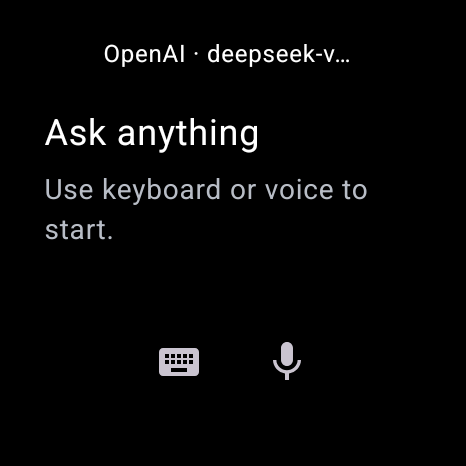
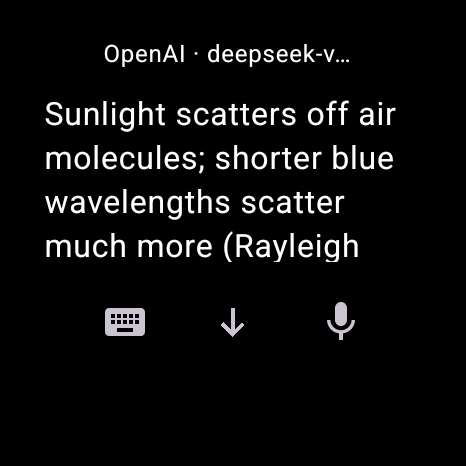
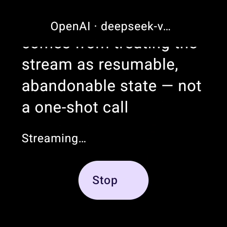
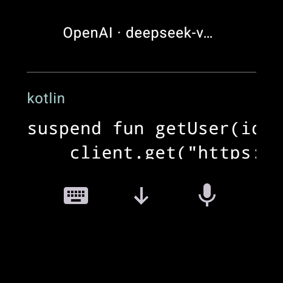
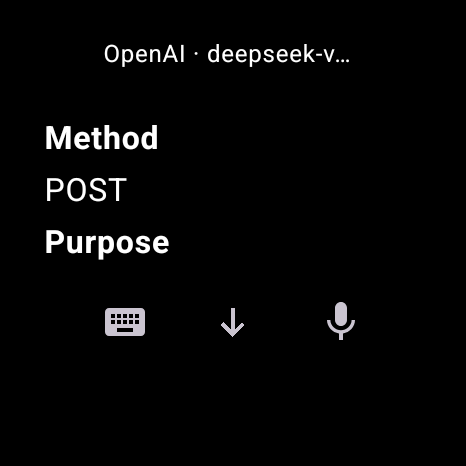
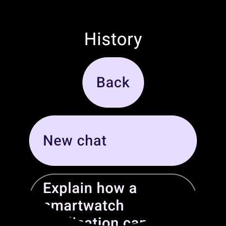

<div align="center">

# NiroWear

**BYOK AI chat for Wear OS. Your provider, your key, your watch.**

Streamed answers that read like a document — Markdown, code, math, tables and links — on a 466 × 466 round display.

[](LICENSE)
[](#requirements)
[](https://kotlinlang.org)

**Website: [michaelxdips.github.io/NiroWear](https://michaelxdips.github.io/NiroWear/)**

[Features](#features) · [Install](#install) · [Provider setup](#provider-setup) · [Architecture](#architecture) · [Evidence](#evidence) · [Contributing](#contributing)

</div>

---

## What this is

NiroWear is a standalone Wear OS chat client that talks **directly** to the AI provider you choose, using **your own API key**. There is no NiroWear account, no backend, no relay and no analytics. Your key is encrypted on the watch with the Android Keystore and is sent only to the endpoint you configured.

It exists because every other way of reading an AI answer on a watch is a compromise: mirrored phone notifications truncate, voice-only assistants can't show a code block, and mobile apps assume a 6-inch screen. NiroWear treats the watch as the primary device.

**Reference viewport:** 466 × 466 px, round (Xiaomi Watch 2 class). Everything is designed against that, not scaled down from a phone.

> NiroWear is an independent client by Stephen Michael — not affiliated with OpenAI, Google, or Anthropic. "Wear OS" and "Android" are trademarks of Google LLC.

## Features

**Four real adapters, four real protocols.** OpenAI Responses, Anthropic Messages, Google Gemini GenerateContent, and generic OpenAI-compatible Chat Completions. The protocol is chosen by the provider type you select — never guessed from a model name. Adding a model never silently changes the wire format. Instruction mapping differs per protocol (`instructions` vs `system` vs `systemInstruction` vs leading `system` message); each adapter owns its SSE framing and its own terminal event. EOF alone is never success — a closed socket without the protocol's completion event is reported as an interruption, not a finished answer.

**Bring your own key, stored properly.** Keys are encrypted with AES-256-GCM under a non-exportable Android Keystore key (randomized IV, version byte + 12 B IV + ciphertext, AAD-bound to the credential reference). Only versioned ciphertext and nonce touch disk; a profile stores a credential *reference*, never the key. A decrypt failure demands re-entry — there is no plaintext fallback, and a saved key is never repopulated into an editing field. Entry is masked (`PasswordVisualTransformation` + `KeyboardType.Password`) and the provider screens set `FLAG_SECURE`. See [Security & privacy](#security--privacy).

**LAN pairing for long keys — designed, shipped, and currently unusable.** The watch can serve a
one-time page on your local network so a key can be pasted into a real form instead of tapped on a
1.4-inch keyboard: ephemeral ECDH P-256 + AES-GCM before it leaves the browser, gated by a 128-bit
single-use capability token shown only on the watch screen, valid for 120 s (+5 s delivery grace), and
closed the moment you leave the screen. The transport is plain HTTP and the handshake is
unauthenticated, so it is not "end-to-end encrypted" in the strict sense. **In practice no browser can
run its crypto at all** — see the note below — so manual entry is the working path.

> **Pairing does not currently work in a browser, and the page now says so.** Browsers only expose
> the Web Crypto API (`crypto.subtle`) on a secure origin — `https`, `file`, `localhost`,
> `127.0.0.1`. The pairing page is served over plain HTTP from a LAN address, which is not one, so
> the API is absent and the page cannot encrypt anything. Measured directly: from a page served the
> way the watch serves it, `window.isSecureContext` was `false` and `typeof crypto.subtle` was
> `undefined`. Rather than loop on "Handshake failed", the page now tells you this and points at
> manual entry. Fixing it properly needs a pure-JavaScript crypto implementation served on that
> origin — a design decision, not a patch. **Until then, add providers by typing the key on the
> watch.**

**Streaming with honest interruption.** Tokens render as they arrive through a 16 ms coalescing throttle (at most one re-parse per frame, never a debounce that starves the view blank). Scroll up and the view stops following you, with a small `Latest` control to jump back. `Stop` cancels the underlying OkHttp call and keeps whatever partial answer had already arrived — it is never replayed automatically. If the provider had already signalled completion, the answer is kept as complete rather than relabelled as stopped: a finished answer is never downgraded. Partial content survives rotation, process death (interrupted streams resume as STOPPED on next launch), and errors.

**One linear conversation.** Editing an earlier user message replaces it, deletes everything after it, and regenerates from that point. Retry truncates the failed assistant message and resends. There are no branches and no alternate-response variants to choose between. Switching provider or model keeps the same history, and each assistant message records which profile and model produced it.

**A reader, not a bubble.** Assistant output is parsed into semantic blocks — headings, paragraphs, lists, quotes, inline code, fenced code, inline/display math, tables, dividers, links — and rendered as a document. Raw Markdown is stored in Room, so the renderer can improve without a migration. Tables become labelled vertical records; a 1000-row table renders at most 40 rows with an explicit "… N more rows" line rather than an ANR.

**Wide content stays readable.** Code and formulas are never shrunk into illegibility. They pan horizontally inside a single vertical reader, so a long line costs a swipe rather than your eyesight. Display math is promoted to a pannable block when it overflows; anything the math renderer deliberately refuses (file-inclusion macros, macro definitions, unbalanced braces) falls back to readable source text, never a blank.

**Math that covers the syllabus.** Greek letters, operators, calculus, set theory, logic, vectors, fractions, roots, powers, subscripts, integrals/sums/limits, matrices (`bmatrix`), cases, and aligned equations — natively typeset in release builds through JLaTeXMath (GPL v2-or-later **with an independent-module linking exception**, which is what permits linking it from MIT code; see [THIRD_PARTY_NOTICES.md](THIRD_PARTY_NOTICES.md) and `assets/legal/`).

**Searchable history.** History carries a full-text search over every stored message. It is a plain
SQLite `LIKE` scan with escaped wildcards — no dependency, no virtual table, no migration, no extra
permission. FTS5 was tried first and measured impossible here: Android's bundled SQLite answers
`no such module: fts5` on a Wear OS emulator, so an FTS index would have crashed the upgrade.

**Watch-sized answers by default.** The system instruction asks for the shortest answer that keeps the required facts and caveats, and to expand when you ask for detail. The client never truncates a long answer to fit the screen.

**Keyboard and voice.** Both are first-class entry points. Voice delegates to the platform recognizer and always returns text you can review before sending.

## Screenshots

Uncropped 466 × 466 captures from the app running against a real HTTPS endpoint.

<table>
  <tr>
    <td align="center"><br /><strong>New chat</strong></td>
    <td align="center"><br /><strong>Streamed answer</strong></td>
  </tr>
  <tr>
    <td align="center"><br /><strong>Streaming + Stop</strong></td>
    <td align="center"><br /><strong>Code reader</strong></td>
  </tr>
  <tr>
    <td align="center"><br /><strong>Tables as records</strong></td>
    <td align="center"><br /><strong>History</strong></td>
  </tr>
</table>

## Requirements

| | |
|---|---|
| Device | Wear OS 3 or newer (API 30+), round display recommended |
| Build JDK | 25 (the Gradle daemon toolchain pins it; app bytecode targets Java 17) |
| Android SDK | Platform 37, build-tools 36.1.0 |
| Gradle | Provided by the checked-in wrapper — do not install separately |

NiroWear is a **standalone** Wear app: it does not require a phone companion and works over the watch's own Wi-Fi or its Bluetooth bridge.

## Install

There is no store listing. Two supported routes:

**Prebuilt APK** — grab `app-release.apk` from [NiroWear releases](https://github.com/michaelxdips/NiroWear/releases) (stable `v0.1.0`). Signed, non-debuggable, versionCode 10. The source in *this* repository builds the same app.

Verify before installing:

```powershell
Get-FileHash .\app-release.apk -Algorithm SHA256
# expect 319AE1CFBC6EE738F0B5B8B4C185F1AB8EBF3718A2B3D2FC43AB612D51934D71
```

```powershell
adb install -r .\app-release.apk
```

> Stable releases live at [`michaelxdips/NiroWear`](https://github.com/michaelxdips/NiroWear) from `v0.1.0` on. The signing identity is still the Android debug key (`CN=Android Debug`, SHA-256 `7D:4E:6E:99:…:AB:E3`), disclosed in the release notes — shipping with a production keystore is an owner decision, not a code change. Historical beta APKs remain at [`NiroWear-Beta`](https://github.com/michaelxdips/NiroWear-Beta) (archived, read-only).

**From source**

```powershell
.\gradlew.bat :app:assembleDebug
adb install -r app\build\outputs\apk\debug\app-debug.apk
```

Then open NiroWear and configure a provider (below).

> Both variants typeset LaTeX natively through JLaTeXMath, which is GPL v2-or-later **with an independent-module linking exception** — that exception is what permits linking it from MIT code. The GPL text, the exception and a corresponding-source offer ship inside the app under `assets/legal/`. See [THIRD_PARTY_NOTICES.md](THIRD_PARTY_NOTICES.md).

## Provider setup

Open **Menu → Providers / model** and pick a preset:

| Preset | Default base URL | Wire protocol |
|---|---|---|
| OpenAI | `https://api.openai.com/v1` | Responses |
| Anthropic | `https://api.anthropic.com/v1` | Messages |
| Gemini | `https://generativelanguage.googleapis.com/v1beta` | GenerateContent (SSE) |
| OpenAI-compatible | *(you supply)* | Chat Completions |

Name and base URL come prefilled. Then get the key onto the watch: **open the provider, type the key, tap Validate, tap Save.** That is the path that works.

> **Pairing from a phone does not work, and the screen says so.** Tapping **Set up from phone**
> starts a one-time listener and shows a URL, but a browser will not run Web Crypto on a
> plain-HTTP LAN origin: `crypto.subtle` is only available in a secure context (`https`, `file`,
> `localhost`, `127.0.0.1`), so the page cannot encrypt anything and tells you to enter the key on
> the watch instead. Measured directly from a page served the way the watch serves it:
> `window.isSecureContext` was `false` and `typeof crypto.subtle` was `undefined`. The listener is
> still there (it is valid for two minutes, one use, and closes when you leave the screen) but it
> cannot complete. Fixing it needs a pure-JavaScript crypto implementation served on that origin —
> a design decision, not a patch.

**Validate · uses API** makes one real (billable) call against the selected model to prove the key and model work together. **Discover models** lists what the provider advertises; discovery failure never blocks manual entry, because compatible endpoints legitimately vary. The app never silently substitutes a model: authentication and listing are separate, and a deprecated or mistyped model surfaces as an error you can read.

### Why keys are annoying, and what we tried

An API key is 40–200 opaque characters. Typing that on a 1.4-inch keyboard is not a friction problem, it is a correctness problem — the failure mode is a silent typo. So the transport looked like the thing to fix, not the keyboard: put the key on a device with a real keyboard and have the watch only receive it.

That design is implemented and does not work, for the reason above: a browser refuses to expose `crypto.subtle` to a plain-HTTP LAN page, so there is nothing to encrypt with. The honest current answer is that the key is typed on the watch once, and `Validate` proves it immediately rather than at first send. Key normalisation at the boundary strips stray whitespace, and a key whose shape contradicts the selected preset shows a warning — nothing is switched automatically.

## Architecture

One application module, no over-engineering (28 Kotlin sources under `app/src/main`):

```
Wear Compose UI  →  ChatViewModel  →  LlmProvider adapter  →  OkHttp → provider
                         ↓
                  Room (history)  +  DataStore (profiles)  +  SecretStore (Keystore)
```

- **Kotlin + Jetpack Compose for Wear OS Material 3**, Coroutines/Flow, Room, DataStore, OkHttp, kotlinx.serialization. No Firebase, no analytics, no crash SDK — `grep` the build files and find nothing.
- **Canonical history is provider-neutral**: USER/ASSISTANT raw content only. Adapters own instruction mapping, request construction, SSE parsing and semantic completion. EOF alone is not success — adapters detect each protocol's terminal event.
- **One generation job per request.** Cancellation propagates into the OkHttp call (`awaitClose { call.cancel() }`). Partial text is durable across Stop, error and process death: checkpoints every 120 ms, final save in `NonCancellable`, interrupted streams marked STOPPED on next launch.
- **Renderer** parses semantic blocks off the main thread (throttled to one parse per 16 ms frame); raw Markdown is retained so the renderer can evolve. The parse memo keeps the last 3 conversations; table rendering caps at 40 rows.
- **No backend.** The only network calls are to the endpoint you configured — HTTPS-only in release (`usesCleartextTraffic=false`), redirects and automatic retries disabled, so a key cannot leak via a 302. Credential-bearing URL query strings are rejected at the endpoint layer.

Deeper reading: [ARCHITECTURE.md](docs/memory/ARCHITECTURE.md), [PROVIDERS.md](docs/memory/PROVIDERS.md), [RENDERER.md](docs/memory/RENDERER.md), [SCOPE.md](docs/memory/SCOPE.md).

## Evidence

Every number below was read from a result file produced on this tree, not quoted from memory. Reproduce any of them:

```powershell
# Unit suite + lint + assemble (CI runs exactly this)
.\gradlew.bat :app:testDebugUnitTest :app:lintDebug :app:ktlintCheck :app:assembleDebug :app:assembleRelease
```

| Check | Result (measured) | Where |
|---|---|---|
| JVM unit tests | 222 / 222, 0 failures, 0 errors, 0 skipped (38 suites) | `app/build/test-results/testDebugUnitTest/*.xml` |
| Connected suite (emulator `NiroWear_Rebook_20261020`, destructive — not a CI gate) | 48 / 48 last recorded 2026-11-02; **not re-run** for this revision | `app/build/outputs/androidTest-results/connected/debug/*.xml` |
| Lint | 0 errors, 1 warning: `GradleDependency` (test runner 1.5.0→1.5.2) | `app/build/reports/lint-results-debug.xml` |
| Release APK | Source builds an **unsigned** `app-release-unsigned.apk`, 3589237 B, SHA-256 `66ABE409…BC6E`. The published `app-release.apk` (3609553 B, `319AE1CF…34D71`) is signed by the release pipeline, not by a local build. Both are `com.nirowear` v10 / `0.1.0`, minSdk 30, targetSdk 37 | `app/build/outputs/apk/release/`, `output-metadata.json` |
| Signing identity | `CN=Android Debug`, SHA-256 `7D:4E:6E:99:…:AB:E3` (disclosed lineage) | `apksigner verify --print-certs`, release notes |
| Fuzz probes | parser/SSE/UTF-8/hostile-LaTeX/zero-width-key corpus: 21/21 PASS, 3000-mutation run clean, 10 MB payload ~360 ms | throwaway harness, not shipped |
| Live site | zero console errors (Edge + mobile shape), all links 200, numbers match release XML | [michaelxdips.github.io/NiroWear](https://michaelxdips.github.io/NiroWear/) |

CI is green on `main` (JVM + lint + ktlint + both assembles); the connected suite is a local pre-release gate because it needs an emulator. Read the full per-claim table — including what is explicitly **unverified** (real-watch battery/thermals, TalkBack audio, production-credential sweeps) — on the [site's evidence section](https://michaelxdips.github.io/NiroWear/#status) and in [docs/release/RELEASE_NOTES_0.1.0.md](docs/release/RELEASE_NOTES_0.1.0.md).

## Security & privacy

- Keys encrypted with **AES-256-GCM** under an Android Keystore key; versioned ciphertext + nonce only, no plaintext fallback. Decrypt failure = re-entry.
- Stored keys are never logged (`Authorization` / `x-api-key` / `x-goog-api-key` redacted), never in URLs/filenames/notifications/errors, never repopulated into editing fields.
- Masked entry by default; provider screens set `FLAG_SECURE` so they cannot be screenshotted by other apps.
- Release networking requires **HTTPS** with platform trust. Redirects and automatic retries are disabled. Credential-bearing URL query strings are rejected.
- Pairing transport is plain HTTP on the LAN by design (a watch cannot present a phone-trusted certificate); the *payload* is ECDH+AES-GCM encrypted and single-use. See the threat-model note under [Features](#features).
- `android:allowBackup="false"` + `data_extraction_rules` exclude everything — credentials are device-bound, so clearing data or uninstalling removes them permanently.
- **No analytics, no crash reporting, no NiroWear backend.**
- Chat text and the key go directly to the endpoint you chose; that provider's retention policy then applies, not ours.

Full facts: [PRIVACY.md](docs/release/PRIVACY.md). To report a vulnerability, use GitHub **Security → Report a vulnerability** (see [SECURITY.md](SECURITY.md)).

## Known limitations

Stated plainly, because a README that hides these is useless:

- **Native math typesetting is in release builds now**, verified by execution on a release APK (a seeded answer produced `Math:` canvas nodes for a display integral and inline `E = mc^2`). The fallback still exists for input the renderer deliberately refuses: file-inclusion macros, macro definitions, and unbalanced braces.
- **Physical Xiaomi Watch 2 acceptance is incomplete.** Emulator evidence is extensive; real-device battery, thermals and input are not yet verified.
- **Voice transcription quality is unaccepted.** The intent launch/return path is tested; recognition accuracy is the platform's.
- **Link taps** open via the system handler; destination completion on a real paired device is unverified.
- **Live smoke tests** are documented against controlled endpoints and one third-party Responses endpoint — not against every official provider with production credentials.
- **TalkBack audio** acceptance is incomplete.
- **Stable releases live at `michaelxdips/NiroWear` from `v0.1.0` on.** `releases/latest`
  redirects to the newest stable build. The signing identity is still the Android debug key,
  which is disclosed in the release notes — shipping with a production keystore is an owner
  decision, not a code change.
- **The connected suite (48 tests) is a local gate, not a CI gate.** It needs an emulator, so CI runs
  the JVM tests, lint, ktlint and both assembles only. Run `connectedDebugAndroidTest` before a
  release; nothing will remind you.
- **Six further instrumentation tests are excluded from the default run.** They carry
  `@HostDrivenGate` and need a host script to seed state. Run them with
  `adb shell am instrument -w -r -e annotation com.nirowear.HostDrivenGate com.nirowear.test/androidx.test.runner.AndroidJUnitRunner`.
- **Known renderer limits, all reproduced on the real parser.** Display math inside a blockquote or
  list is destroyed rather than shown as source (`> \[x^2\]` loses its delimiters). A fence opened
  inside a quote can be closed by a `> ``` ` line. An over-wide table row loses cells with no
  marker. `$$…$$` mid-line leaves a stray `$`. A link with a rejected scheme is still painted as
  tappable even though tapping does nothing. Tables are capped at 40 rendered rows with an explicit
  "… N more rows" line. These are documented rather than fixed; each needs a design decision.
- **Pairing does not work in a browser on a plain-HTTP LAN origin.** Browsers only expose Web Crypto
  on a secure origin, so the watch's page explains this and points at manual entry.
- **A physical watch has not run this build.** Every timing and input claim here was measured on an
  emulator.

## Contributing

Issues and pull requests are welcome. Read [CONTRIBUTING.md](CONTRIBUTING.md) and [AGENTS.md](AGENTS.md) first — the latter documents the product and engineering contracts that keep the app coherent.

Two rules that matter more than style: **never commit a real API key**, and **do not add a feature from the out-of-scope list** in [SCOPE.md](docs/memory/SCOPE.md) without discussing it first.

## License

Application source is **MIT** — see [LICENSE](LICENSE). Copyright © 2026 Stephen Michael.

Third-party dependencies keep their own licenses; see [THIRD_PARTY_NOTICES.md](THIRD_PARTY_NOTICES.md) and [docs/licenses](docs/licenses/README.md). One dependency is non-permissive: `jlatexmath-android` is GPL v2-or-later **with an independent-module linking exception**, which explicitly permits linking it with MIT code and distributing the result under terms of your choice. The GPL text and the library notice ship in `app/src/main/assets/legal/`.

"Wear OS" and "Android" are trademarks of Google LLC. NiroWear is not affiliated with or endorsed by Google, OpenAI, Anthropic, or any model provider.
